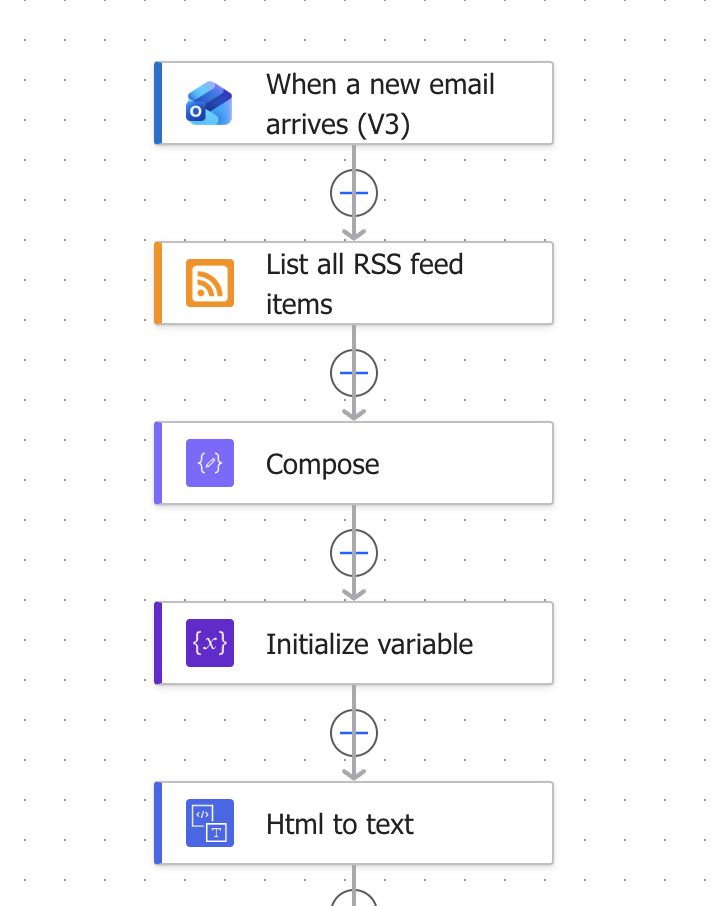
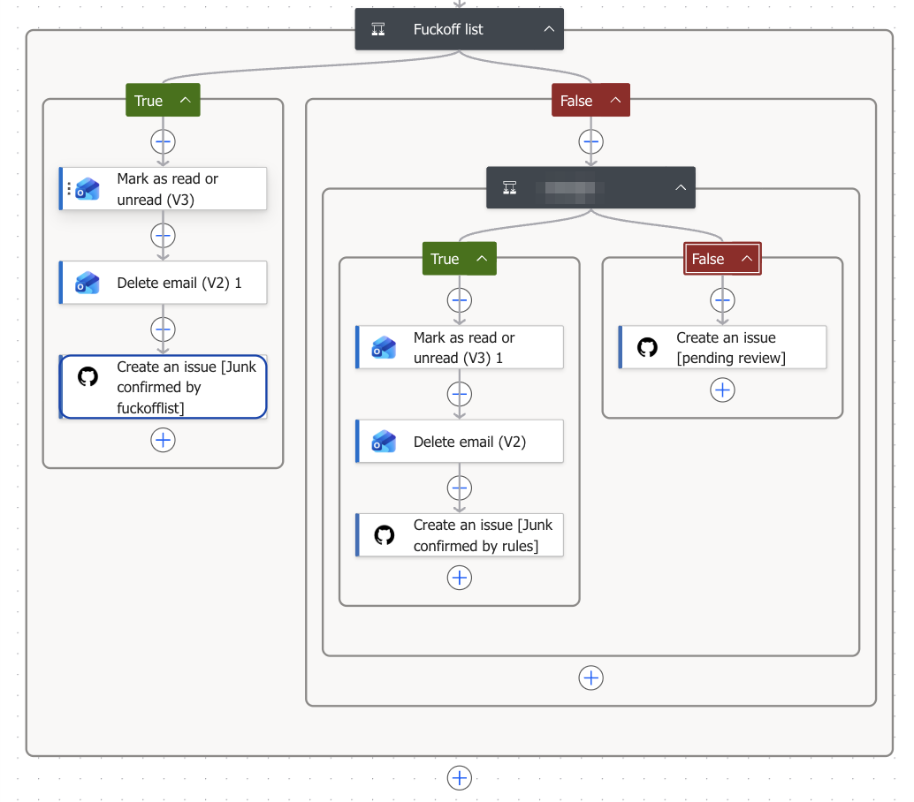
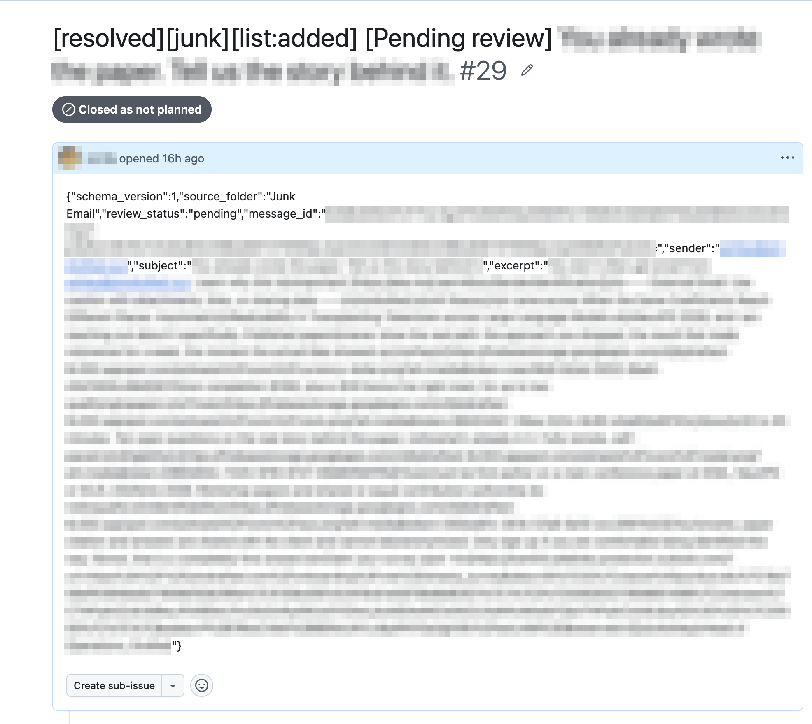
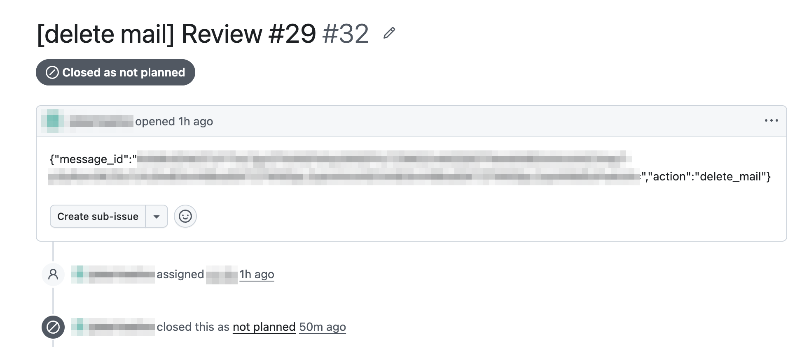
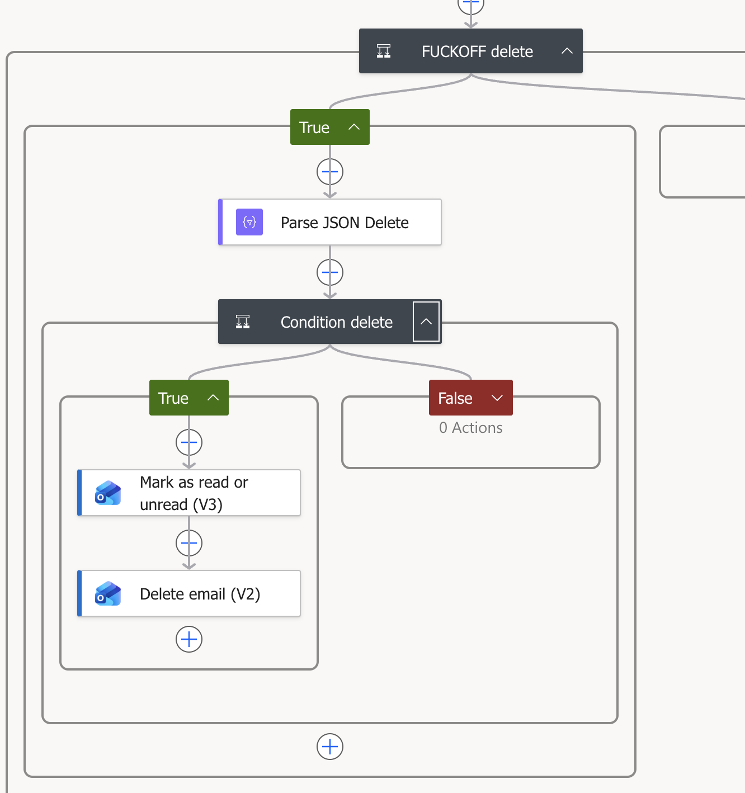
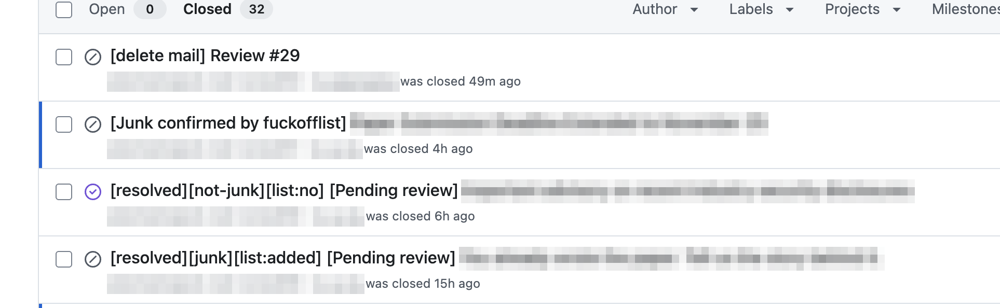

# "Get me off Your Fucking Mailing List"

In 2005, David Mazières and Eddie Kohler wrote a paper called "Get me off Your Fucking Mailing List." The text is that sentence, over and over, with figures that also say it. They wrote it as a reply to a conference that kept spamming them. In 2014 it was forwarded to the *International Journal of Advanced Computer Technology* in response to that journal's own spam, and the journal [accepted it](https://en.wikipedia.org/wiki/International_Journal_of_Advanced_Computer_Technology), with a reviewer rating of "excellent" and a request for a $150 fee.

I think about that paper every time I open my school email.

## The problem

My university's Outlook spam filter sends nearly everything to Junk. Predatory journals and ads end up there, which is fine, but so do emails I actually need to read. Junk becomes one big pile, and every day I had to dig through it, fishing out the few emails that mattered from between calls for papers by journals I had never heard of. It didn't take long, but it happened every single day, and it irritated me far more than the minutes it cost.

To be fair to Outlook, its default settings would probably handle most of this just fine. But the university's IT team has evidently thought about spam harder than the people who built Outlook. I'm sure they have their reasons. I'm sure the reasons are excellent. And I'm sure someone, somewhere, is safer now that the email I was waiting for sits in Junk, sandwiched between two calls for papers.

The usual fixes don't help. Outlook's Blocked Senders list moves mail to Junk, which is the pile I'm trying to clean up. The newer fix, letting an AI assistant read my mailbox, is off the table too, at least when the assistant is ChatGPT: the university blocks ChatGPT's OAuth connection to school email. Copilot, meanwhile, is switched on inside Outlook. I'm sure there's an excellent reason one AI may read my email and the other may not.

The Power Automate part isn't new. I built the first version of this flow last year, with the same fuckoff list deleting anything from a listed domain. The catch was that I maintained the list by hand: every new junk sender meant opening the email, deciding it was junk, and copying its domain into the list myself. Then I got lazier, and I stopped believing that spending time on this kind of email every day was a reasonable choice. So I designed the rest of the system to take me out of the loop.

The new design never connects anything outside Microsoft to the mailbox. Power Automate, Microsoft's own automation tool, still does everything inside Outlook. A [dot](https://openai.com/index/introducing-dots/), one of OpenAI's always-on agents, takes over my old job of judging the junk and keeping the list. The two never talk to each other directly. They pass JSON back and forth through GitHub issues. It's a roundabout setup, but with GPT kept out of the mailbox, the long way around was the only way.

Junk now gets deleted on its own, and once the dot flags a domain, every later email from it goes straight to Deleted Items. What's left in Junk is mostly real email that Outlook misfiled, so I read it like a second inbox.

Nothing is self-hosted. It runs on Power Automate and GitHub.

## How it works

The building blocks look odd, and that's because of cost. Power Automate's standard connectors, which include Outlook, RSS, and GitHub, are free for me to use. Most of what a sensible design would reach for, like the generic HTTP action for calling an API, is a premium feature that costs extra. GitHub issues and releases are free. So the blocklist is an RSS feed, and the message queue is an issue tracker.

### Fetching the blocklist

A Power Automate flow runs on every new email that lands in Junk. The first thing it does is fetch the blocklist.

The blocklist lives in GitHub releases. Every GitHub repository publishes its releases as an Atom feed at `https://github.com/<owner>/<repo>/releases.atom`, and Power Automate's built-in RSS action reads that feed like any other news feed. A Compose step pulls the blocked domains out of the feed items. That turns the release page into a small database that is versioned and writable by anything with access to the repo, including the dot. There is no server and no database to run.

The flow also converts the email body from HTML to plain text, so the rules below can match against it.

### Three branches

Each email then goes down one of three paths:

1. **The sender's domain is on the blocklist.** The flow marks it as read, deletes it, and opens a GitHub issue tagged "Junk confirmed by fuckofflist."
2. **The email matches a sender rule.** Same actions, tagged "Junk confirmed by rules."
3. **Neither.** Nothing is deleted. The flow opens an issue tagged "pending review" and leaves it for the dot.

The sender rules handle the simple solicitations and junk. They are plain string matches: the lowercased text contains "submit your research," "publication opportunity," or "scopus"; it contains 征稿 (call for papers) or 邀请 (invitation); the subject starts with "For Your Article"; or the sender is one of a handful of names that show up often enough to list directly.

Some of these rules exist because the blocklist can't help. A few senders, mostly training companies and junk conferences, switch to a new domain practically every day. Their emails, though, follow the same template every time. I've read so many of them that I feel like we know each other, and a string match catches them no matter which domain they come from this week.

<!--  -->

### The dot reviews

The dot has its own GitHub account. Everything happens in a private repo that only the dot and I can access, and the pending-review issues there are its inbox. Power Automate writes each email into the issue body as JSON: the folder it came from, a review status, the Outlook message ID, the sender, the subject, and an excerpt of the body.

The dot reads the issue and decides whether the email is junk. It writes the verdict into the issue title, `[resolved][junk][list:added]` or `[resolved][not-junk][list:no]`, and closes the issue. If the email is junk, the dot also adds the sender's domain to the blocklist, so the next email from that domain is caught by the first branch before any model looks at it.

Blocking a whole domain sounds heavy-handed, but it fits the senders. Junk solicitations and ads rarely come from real domains. They come from cheap, disposable ones under .top, .xyz and the like, which nobody else sends real mail from, so blocking them costs nothing. To keep it from going wrong in the other direction, there is a whitelist of domains that never get blocked: common mail providers like Gmail and Outlook, large companies, and anything under .edu or .gov.

### Power Automate deletes

The dot can't delete anything itself. Instead, it opens a second issue containing a one-line command, the message ID plus `"action":"delete_mail"`, and assigns that issue to me.

A second Power Automate flow picks up the assignment, parses the JSON, checks that the action is `delete_mail`, and deletes the email with that message ID.

### The log

Every email leaves a GitHub issue, whichever branch it takes, and the title records the verdict. That gives me a searchable record of what was deleted and why. Deleted email goes to Deleted Items rather than being purged, so if something important ever goes missing, I can search the issues, see which branch caught it, and pull it back out.

## Numbers so far

The first test run of the dot version was on October 6, and the first real email came through on the evening of October 10, so it has been handling real mail for about two weeks. Leaving out test runs and duplicate delete commands, 23 emails have gone through it:

- 9 were caught by the blocklist and deleted without a model ever seeing them.
- 0 were caught by the sender rules.
- 14 went to the dot. It judged 10 of them junk and 3 not junk, and it is still unsure about 1.

So 19 of the 23 were junk and are gone. The 3 the dot cleared and the 1 it couldn't decide are what's left in Junk, and those are the ones I actually need to look at. Four emails in two weeks is a second inbox I can live with.

The sender rules didn't fire in these two weeks, but that undersells them. Earlier runs of the flow didn't open issues, so whatever the rules caught before is not in these numbers, and I couldn't be bothered to count it by hand. Twenty-three emails is a small sample anyway, so I wouldn't read much into the ratios yet.

## Why I like this setup

The obvious alternative is computer use: give an agent a browser, log it into Outlook on the web, and let it click through my Junk folder. That worries me. An agent clicking around a live mailbox can do anything I can do there, including opening the wrong email, replying to it, or following a link. Its whole job would be reading spam, which is exactly the kind of text written to manipulate whoever reads it. If it goes wrong, it goes wrong inside my account.

Power Automate is much more constrained. Each flow is a fixed sequence of actions I wrote in advance, and the dot's only lever is to trigger one of them. It never sees my mailbox, only the few fields the first flow chooses to post from emails already sitting in Junk. The only thing it can ask for in return is the deletion of one message, and the second flow ignores anything that isn't a well-formed `delete_mail` command.

It can also only name messages I've already shown it. The dot has no way to look up message IDs on its own; the only ones it ever sees are the ones my flow posted, so it can't delete an email I never handed over. Only issues in that one private repo can trigger the flow, so nobody else can delete my mail, and the email excerpts sit where only the dot and I can read them. The worst a confused dot can do is delete a Junk email it shouldn't have or block the wrong domain, and the whitelist means the wrong domain can't be Gmail or a university. Either way the mail lands in Deleted Items, an issue records what happened, and I can undo it.

The model is also only consulted when the cheap checks can't decide. Every junk verdict it reaches becomes a domain match that costs nothing to run from then on. The blocklist grows by itself, and the fraction of my email that needs a model's judgment should keep shrinking.

## Nothing to host

Power Automate runs in Microsoft's cloud under my school account. GitHub holds the blocklist, the review queue, and the log. The dot runs on OpenAI's computers. My laptop can be off, and there is no server for me to keep alive.

Mazières and Kohler sent their request as a paper, and the journal that got it rated it excellent. I've stopped asking to be taken off anyone's list. I keep my own list now, and they're on it.
